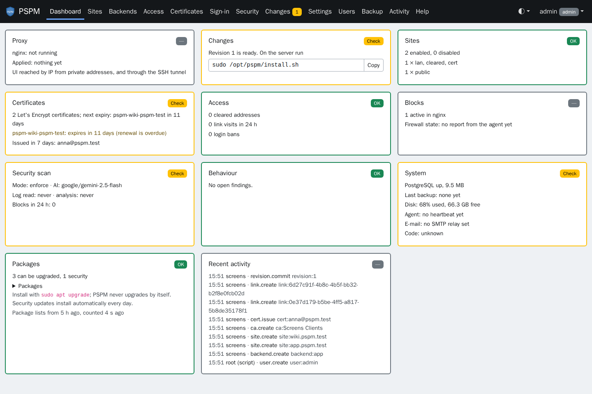
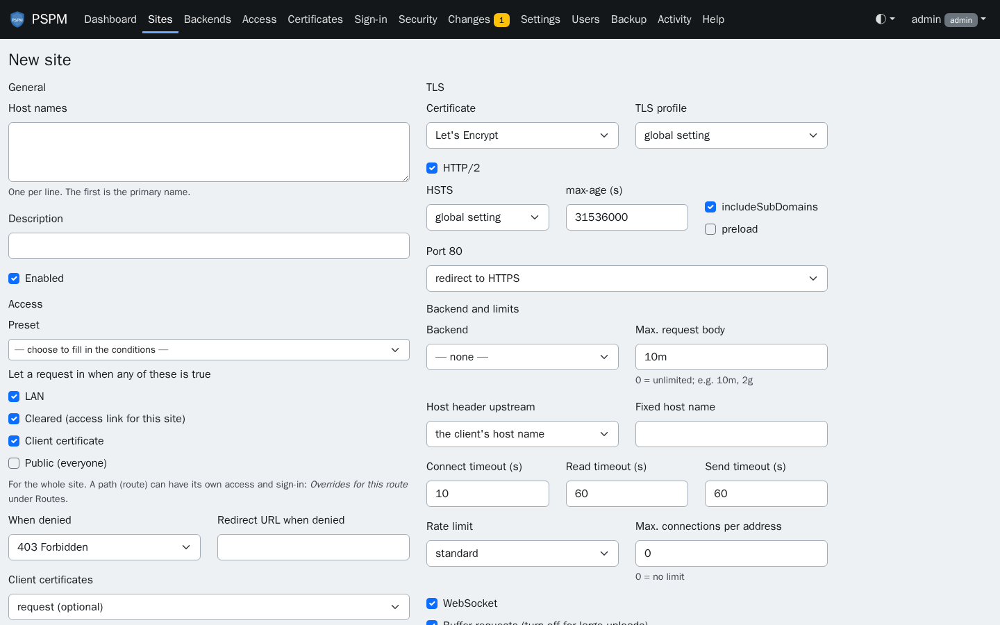
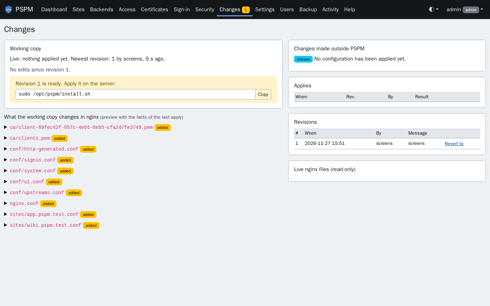
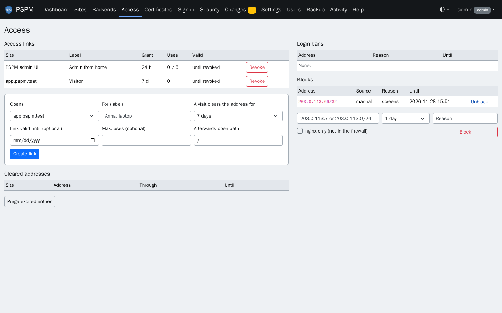
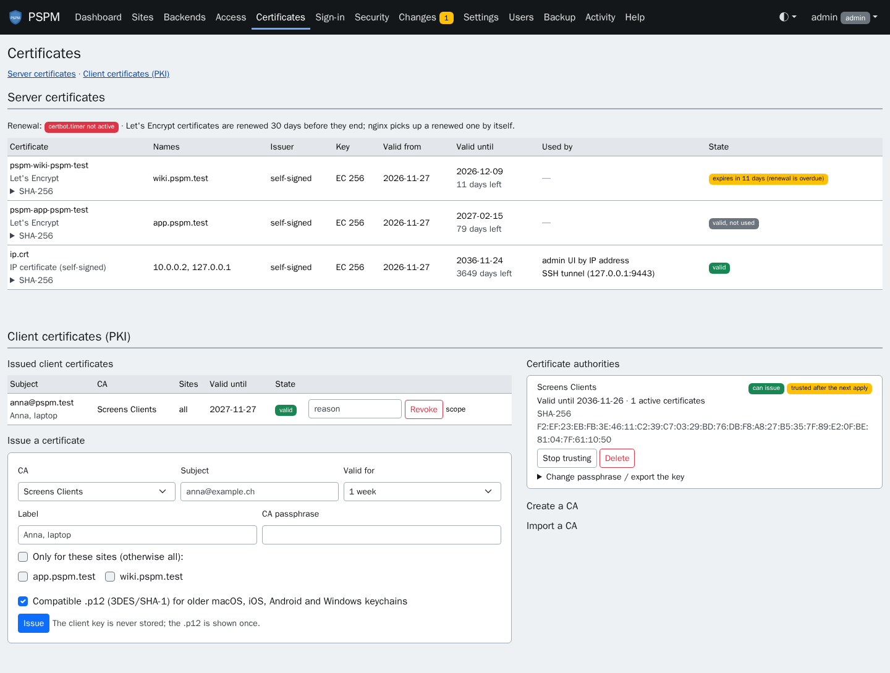
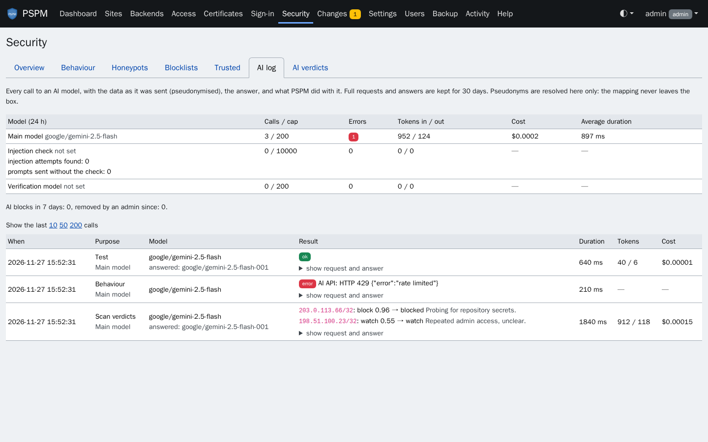
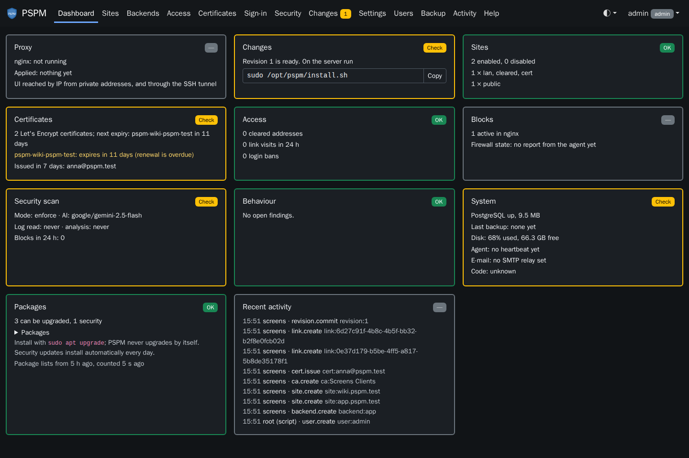

<p align="center">
  
</p>

<h1 align="center">PSPM</h1>

<p align="center">
  <b>Philipp's Secure Proxy Manager</b><br>
  A reverse-proxy appliance for one Debian box – every site behind TLS and an access policy,
  attackers blocked in nginx and in the firewall, every change reviewed before it goes live.
</p>

<p align="center">
  
  
  
  
  
  
  <a href="LICENSE.md"></a>
</p>

<p align="center">
  <a href="#screenshots">Screenshots</a> ·
  <a href="#features">Features</a> ·
  <a href="#architecture">Architecture</a> ·
  <a href="#install">Install</a> ·
  <a href="#daily-use">Daily use</a> ·
  <a href="docs/pspm-plan.md">Design plan</a>
</p>

<p align="center">
  
  <br>
  <sub>The dashboard: one tile per area with its state, and the command to run when changes are ready.</sub>
</p>

PSPM turns one Debian 13 box into a reverse proxy for any number of sites. nginx terminates TLS and enforces a
per-site access policy: LAN, access links and client certificates, plus sign-in with Microsoft either as an
alternative or on top. Hostile addresses are blocked in nginx and in the kernel firewall, by honeypots and by AI
verdicts. Everything is configured in the web UI. An admin applies it over SSH with `install.sh`, which shows what
opens access, tests the new configuration, switches to it atomically and rolls back on its own if anything fails.
**Nothing in the web UI leads to root.**

## Screenshots

<table>
  <tr>
    <td width="50%" valign="top">
      
      <p><b>A site.</b> Host names, TLS, the backend and the access policy on one page. Routes give a path its
      own backend, access or sign-in.</p>
    </td>
    <td width="50%" valign="top">
      
      <p><b>Changes.</b> Edits land in a working copy. The preview lists every nginx file that changes;
      <i>Ready to apply</i> hands a revision to <code>install.sh</code>.</p>
    </td>
  </tr>
  <tr>
    <td width="50%" valign="top">
      
      <p><b>Access links and blocks.</b> A visit to an access link clears the visitor's address for one site,
      for a while. Blocks reach nginx and the firewall.</p>
    </td>
    <td width="50%" valign="top">
      
      <p><b>Certificates.</b> Let's Encrypt and the IP certificate with their expiry, and a client-certificate
      CA whose key stays on the box, wrapped with a passphrase.</p>
    </td>
  </tr>
  <tr>
    <td width="50%" valign="top">
      
      <p><b>The AI log.</b> Every model call: what was sent (pseudonymised), the answer, tokens, cost and what
      PSPM did with it.</p>
    </td>
    <td width="50%" valign="top">
      
      <p><b>Light and dark.</b> The theme follows the system or is chosen in the menu bar.</p>
    </td>
  </tr>
</table>

<sub>Demo data on a throwaway database, taken with `tests/screenshots.sh`
([tests/screens-seed.php](tests/screens-seed.php)).</sub>

## Features

- **Sites and routes:**
  - several host names per site, Let's Encrypt or plain HTTP, HTTP/2, HSTS, limits, timeouts and WebSocket;
  - backends with several servers, backup servers, TLS verification and keepalive;
  - routes per path with their own backend, redirect or status, access and sign-in. An application that runs at
    `/` can sit under `/site1/`.
- **Access policy per site and route:** *LAN*, *cleared* (an access link was visited), *client certificate* or
  *public*; any of them lets a request in. **Sign-in with Microsoft Entra ID** comes on top (*required*) or as an
  alternative:
  - oauth2-proxy with sessions in Redis, re-checked at Microsoft (every hour by default);
  - allowed groups, e-mail addresses and domains per site;
  - identity headers for the backend that a client can never set itself.
- **Certificates:**
  - Let's Encrypt, renewed by itself;
  - an IP certificate for reaching the UI by address;
  - a client-certificate PKI with the CA key on the server, revocation, per-site scopes and `.p12` files that
    older keychains can open.
- **Blocking:**
  - `block.lua` refuses blocked addresses in nginx, and `pspm-agent` loads the same lists into ipset and
    iptables, for every port;
  - honeypots learn exploit paths and block at the first request;
  - external blocklists, login bans, blocks that escalate from 1 to 7 to 30 days, and a trust registry of
    addresses that are never blocked.
- **AI-assisted security scan** with any OpenAI-compatible API (e.g. OpenRouter):
  - verdicts on suspicious addresses every 5 minutes, and a verifier model for automatic blocks;
  - behaviour analysis (brute force, enumeration, scraping, leaked links) with reaction deadlines;
  - an injection check before the model, pseudonyms instead of addresses, guards no AI can override, a circuit
    breaker, and the AI log.
- **Safe apply:**
  - `install.sh` reviews what changes and marks what opens access (`OPENS`);
  - `nginx -t`, an atomic switch, checks afterwards and an automatic rollback;
  - revisions, `rollback`, and detection of changes made outside PSPM.
- **Operations:**
  - the dashboard and e-mail notifications;
  - backups before every install and every night;
  - export and import of everything as one JSON file, with secrets encrypted;
  - a debug report with secrets redacted, recovery scripts and a firewall kill switch.
- **The UI itself:**
  - password and mandatory TOTP, with re-authentication for sensitive actions;
  - roles *admin*, *operator* and *viewer*;
  - reachable from private addresses, an admin host name or an SSH tunnel.

## Architecture

```
                          Debian 13 host
 internet ─▶ netfilter  PSPM-INPUT: private ranges, allow sets ─▶ pass
               │                    block set, blocklist set  ─▶ DROP   (every port)
               ▼
            nginx (workers: www-data)
               │  rewrite  block.lua ─┐
               │  access   gate.lua  ─┼─▶ shared dicts ◀── load ── snapshot files
               │     │                │                          /var/lib/pspm/state/
               │     └─ sign-in check ─▶ Docker: oauth2-proxy, 127.0.0.1 ─▶ identity provider
               ├─▶ backends           │                              ▲          ▲
               ▼                      │                      writes  │          │ reads
            php-fpm pool "pspm" ──────┴── UI · access links · scan job · blocklist fetcher
               │ Unix socket          reads, never writes: live nginx releases,     │
               ▼                      logs, public certificates, /proc              │
            Docker: postgres:18 (network: none)                                     │
                                                                                    │
 root only:  install.sh  (packages, migrations, app release, render + apply nginx
                          and oauth2-proxy, certificates, code updates)             │
             pspm-agent  (loads the firewall sets from the snapshot files ──────────┘,
                          writes status JSON for the dashboard)
```

The web UI writes to PostgreSQL and to snapshot files; it never writes code, nginx configuration or certificates,
and never runs anything as root. nginx reads the snapshot files into shared memory and never opens the database.
The agent is the only root process that reads data the UI wrote: lists of addresses, each one validated, for its
own firewall sets. Everything else that needs root goes through `install.sh` over SSH. Details:
[docs/pspm-plan.md §3](docs/pspm-plan.md#3-architecture).

## Install

From a fresh Debian 13:

1. Install Debian 13 (netinst): only **SSH server** and **standard system utilities**. Give the box a fixed address.
2. As root:
   ```bash
   apt-get update && apt-get install -y git
   install -d -m 700 /root/.ssh
   ssh-keygen -t ed25519 -N '' -C "pspm@$(hostname -f)" -f /root/.ssh/pspm_deploy
   cat >> /root/.ssh/config <<'CFG'
   Host github.com
       IdentityFile /root/.ssh/pspm_deploy
       IdentitiesOnly yes
   CFG
   cat /root/.ssh/pspm_deploy.pub
   ```
3. On GitHub: the repository's *Settings → Deploy keys → Add deploy key*; paste the key, **write access off**.
4. Clone and install:
   ```bash
   ssh -T git@github.com            # compare the fingerprint with GitHub's published ones
   git clone git@github.com:<owner>/pspm.git /opt/pspm
   /opt/pspm/install.sh
   ```
   The first run asks nothing. At the end it prints the URLs (by IP, from private addresses), the IP certificate's
   fingerprint and the password of the user `admin` (once). Sign in, choose a password, enrol an authenticator.

Then: add a backend, add a site, open *Changes*, click *Ready to apply*, and run `sudo /opt/pspm/install.sh`.

## Daily use

| | |
|---|---|
| Apply what is marked *Ready to apply* | `sudo /opt/pspm/install.sh` (or `… apply`) |
| Deploy new code | `sudo /opt/pspm/install.sh update` |
| Back to the previous configuration | `sudo /opt/pspm/install.sh rollback` |
| What is live, URLs | `sudo /opt/pspm/install.sh status` |
| Health checks | `sudo /opt/pspm/install.sh doctor` |
| Debug bundle (one text file, secrets redacted) | `sudo /opt/pspm/install.sh report` |
| Firewall kill switch | `sudo /opt/pspm/install.sh firewall off` / `on` |
| UI through SSH | `ssh -L 9443:127.0.0.1:9443 root@<box>`, then `https://localhost:9443/` |
| Recovery | `scripts/reset-password.sh`, `reset-otp.sh`, `create-admin.sh`, `unblock-ip.sh` |

Every `install.sh` run writes `/var/log/pspm/install-<time>.log` (`install-latest.log` points to the newest): the
machine, every command with its output, exit code and duration, the phases and a summary.

## Development

Everything runs in containers on the dev machine; the test image is Debian 13 with nginx, Lua and PHP 8.4.

```bash
docker build -t pspm-test:trixie tests/docker
docker run --rm -v "$PWD:/src:ro" pspm-test:trixie php /src/tests/unit/run.php
docker run --rm -v "$PWD:/src:ro" pspm-test:trixie bash /src/tests/nginx-check.sh
bash tests/run-smoke.sh
bash tests/screenshots.sh .tmp/screens /settings /certificates
```

| Test | What it covers |
|---|---|
| `tests/unit/run.php` | validation, rendering, the `install.sh` review |
| `tests/nginx-check.sh` | the rendered configuration through `nginx -t`, then a running nginx in front of an echo backend |
| `tests/run-smoke.sh` | the UI, PKI, security, export and import, against PostgreSQL 18 and Mailpit |
| `tests/box-e2e.sh` | `install.sh` end to end in a Debian 13 box with systemd, nested Docker, real oauth2-proxy and Redis (`tests/docker/systemd`) |
| `tests/screenshots.sh` | light and dark screenshots with Playwright; `FULL_PAGE=0` for the first screen only |

```
app/          web UI (PHP 8.4): pages, lib (renderer, validation, PKI, sign-in, AI, …), bin, help, assets
lua/          nginx Lua: block.lua, gate.lua (access and sign-in), snapshot reload, unknown host names
install.sh    the entry point; installer/ holds its phases, apply and commands
agent/        pspm-agent: firewall sets (ipset, iptables) and status for the dashboard
systemd/      services and timers: scan, analysis, backups, blocklists, notifications, apt, agent
db/           PostgreSQL migrations          docker/    PostgreSQL compose file
scripts/      recovery, backup, export       nginx/     static configuration and error pages
tests/        unit, nginx, smoke, e2e        docs/      design plan and notes
```

## Documentation

| | |
|---|---|
| **Design** | [Design plan](docs/pspm-plan.md) · [AI security](docs/security-ai-improvements.md) · [MCP connector (plan)](docs/mcp-connector.md) |
| **In the UI** (*Help*) | [Getting started](app/help/index.md) · [Access](app/help/access.md) · [Applying, rollback, drift](app/help/applying.md) · [Sign-in with Microsoft](app/help/signin.md) · [Recovery](app/help/recovery.md) |

## Licence

Copyright © 2026 Philipp Albrecht.

PSPM is licensed under the [PolyForm Strict License 1.0.0](LICENSE.md)
(<https://polyformproject.org/licenses/strict/1.0.0>). It is source-available, not open source:

- **Allowed:** using it for any noncommercial purpose. That covers personal study, research, experiments and hobby
  projects, and use by charities, schools and universities, public research, public safety and health organisations,
  and government institutions.
- **Not allowed:** commercial use, redistributing it, or changing it or building on it.

For anything else, such as commercial use, ask the licensor for a separate licence.

Bundled third-party code keeps its own licence: [PHPMailer](app/vendor/phpmailer) (LGPL 2.1),
[Bootstrap](app/assets/vendor) (MIT) and the QR code generator by Kazuhiko Arase (MIT).
